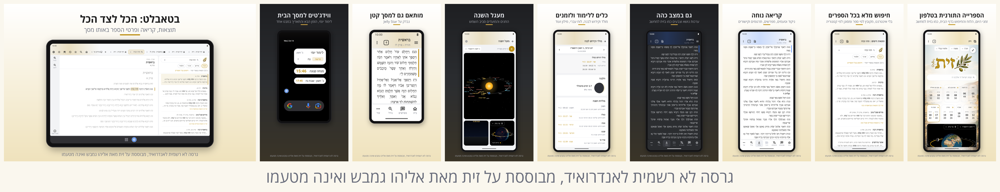

# Pardes (פרדס), an Android app based on Zayit

Pardes is an Android 13+ (minSdk 33) app based on [Zayit](https://github.com/kdroidFilter/Zayit), the open-source (AGPL-3.0) desktop app by Elie (Elyahou) Gambache. He did not make Pardes, is not responsible for it and does not support it, so please don't report its problems to him or to the Zayit project. It was called "Zayit for Android (unofficial port)" until October 2026; at his request it now has its own name and icon (the word פרדס in gold on olive green) and its own application id, `io.github.efrul.pardes`. It reuses the desktop's `SeforimLibrary` core and dao code unchanged, and redraws the UI in Jetpack Compose to look and behave like the desktop "Islands" layout on phones (down to the 3" Unihertz Jelly Star) and tablets. See [DESIGN.md](DESIGN.md) for the screen-by-screen mapping.



The images are in [docs/release/](docs/release/).

Download page: https://efrul.github.io/Pardes/ (source in [site/](site/), deployed to GitHub Pages by `.github/workflows/android-site.yml` on every push that changes it). On every visit it asks the GitHub API for the newest release, its version and the downloads of every release's APK (when the API cannot be reached, it shows `releases.json`, written at each deploy); it shows [CHANGELOG.md](CHANGELOG.md) as its changelog and also offers the transfer scripts.

## Build

This is a standalone Gradle build. It compiles SeforimLibrary (core, dao, search) from `upstream/SeforimLibrary`, a submodule pinned to the commit desktop Zayit 0.6.1 was built with (381fbea), and reads `../htmlparser` and `../SeforimApp/src/commonMain/sqldelight` from the repository. The root `../SeforimLibrary` submodule is the older one the desktop fork builds with; Android doesn't use it.

```bash
git submodule update --init androidApp/upstream/SeforimLibrary   # once, after cloning
cd androidApp
echo "sdk.dir=/path/to/android-sdk" > local.properties
./gradlew :app:assembleRelease    # R8-minified APK (~23 MB, mostly fonts and wallpapers), signed with the shared debug key
./gradlew :app:assembleDebug      # unminified, debuggable
```

Requirements: JDK 21+ (`lucene-android/` compiles against lucene-core's Java 21 class files, which javac 17 cannot read), Android SDK 36. The JBR bundled with Android Studio is a JDK 21. Building on Windows is covered in [docs/DEVELOPMENT.md](docs/DEVELOPMENT.md#working-on-windows).

Both build types are signed with the project's debug key, `debug.keystore` (CN=Pardes Android Debug), so builds from different machines install over each other.

**CI release.** `.github/workflows/android-release.yml` runs the same release build on GitHub Actions (JDK 21, SDK 36). It runs only by hand, never on a push: Actions › Android release › Run workflow, on `main`. It signs the APK with Pardes's own key, which only the repository's secrets hold, and stops unless the APK carries that key's certificate. It also stops unless `lucene-android/check-api33.sh` reports 0 missing references, then publishes a release marked Latest (so it shows on the repository page), tagged `android-<versionName>-<run number>`, with the APK (`pardes-android-0.2.0-7.apk`), its complete source including the SeforimLibrary submodule (`pardes-android-0.2.0-7-source.tar.gz`, since GitHub's own source archives leave submodules out), `push-desktop-library-windows.zip` (the `.ps1` with its `.cmd` launcher) and `push-desktop-library.sh`. `versionName` in `app/build.gradle.kts` sets the tag. The release notes say what is new from that version's section of [CHANGELOG.md](CHANGELOG.md) (`## <versionName> · <date>`), and the run stops before the build when there is none: write it, and raise `versionName` and `versionCode`, before a release.

## Getting a library onto the device

- **On a phone:** the first-run flow downloads the same release that desktop uses (about 5.5 GB). It downloads and extracts in one streamed pass, so the compressed bundle is never stored, and it resumes after a dropped connection. It keeps everything desktop installs, search indexes included (13.06 GB unpacked: `seforim.db` 8.02 GB, `seforim.db.lucene/` 4.95 GB, `lexical.db` 81 MB…), and needs about 14.1 GB free.
- **From a computer with desktop Zayit:** `tools/push-desktop-library.sh` (Linux/macOS) or `tools/push-desktop-library.ps1` (Windows; double-click `push-desktop-library.cmd` next to it, which runs it with the execution policy bypassed and keeps the window open; the site and releases offer both in `push-desktop-library-windows.zip`) copies the installed desktop library over adb and makes it writable for the app, with no download and no root. The `.sh` streams each file straight into place, so the phone needs the library's size plus 0.5 GB free (about 13.6 GB). adb on Windows cannot stream binary data that way, so the `.ps1` passes each file through a staging folder on the phone, a file over 2 GiB in pieces of that size, and needs 2 GiB on top, about 15.7 GB. `--sdcard` (`-SdCard`) copies to the memory card instead, seforim.db in chunks on a FAT32 card, and then removes a library in the phone's storage, so that the app keeps one. It does so only for Pardes 0.3.0 or later (versionCode 2), which can open a library on the card. With `-SdCard` the `.ps1` still stages each file on the phone, so the phone needs about 2.2 GB free besides the card's 13.6 GB. Both can replace a library the app downloaded itself. `--with-notes` (`-WithNotes` in the `.ps1`) also brings the desktop notes and highlights; `--dry-run` (`-DryRun`) prints the adb commands. They need adb: on PATH, in the Android SDK, or Google's Platform-Tools unzipped next to the script. The `.sh` looks only in `platform-tools/` beside it; the `.ps1` also finds it up to three folders deeper, since Explorer's "Extract All" nests it one level down.
- **Offline:** choose the `.part` files, a `.tar.zst`, or a ready `seforim.db` with the system file picker. A bare `seforim.db` brings no search index, so search stays off until a full install.
- **Updating without a network:** Settings › ניהול נתונים › "עדכון מקבצים" or "עדכון מתיקייה". Pick the two files of an incremental update from the SeforimLibrary release page, `patch-v<from>-v<to>.db.zst` and its `.manifest.json` (several steps chain by their content hashes). Or pick every `.part` file of a full release, with its manifest. A full update leaves the working library in place until the new one has been read to the end and checked, when there is room for both. It deletes the old one first only when that makes the room, and otherwise stops before deleting anything. A bundle packed by a tool may start with `release_info.txt` and `library_size.txt` (`library=<bytes unpacked>`): an edition too old for the app is then refused, and the free space checked, with nothing deleted.
- **For development:** `tools/make_subset_db.sh` builds a small `seforim.db` (Bereshit, Berakhot and Mishnah Berakhot, with their commentaries) from a full database. Push it to `/sdcard/Android/data/io.github.efrul.pardes/files/seforim.db`; the app adopts it on start.

## The library on a memory card

A library of 13 GB fits on a memory card (an SD card that Android mounts as portable storage). Pardes keeps it in its own folder on the card, `Android/data/io.github.efrul.pardes/files/library/`, which needs no storage permission. Android deletes that folder when the app is uninstalled, as it does on the phone.

- **Choosing:** with a card in the device, the first-run disk step lists the phone and the card with their free space.
- **Moving:** Settings › ניהול נתונים › "מיקום הספרייה" moves the library between the phone and the card. The copy runs in the background with a notification. Each file is checked: its size, and a checksum of its end, read back after the app asks Android to drop the copy's cached pages. This makes sure the copy is complete. It can also reveal a fake-capacity card, which loses the end of what is written to it, but it cannot promise to: Android may still serve the read from its cache. The old copy is deleted only once the new one is in place, and then the app starts again. A library found in the other place, for example one copied onto the card from a computer, can be switched to or deleted there.
- **Card taken out:** the app asks for the card and opens by itself once the card is back. It never downloads the library again on its own. Taking the card out while the app runs closes the library first and starts the app on that screen.
- **FAT32 cards** (Android formats cards of 32 GB and less that way) take no file of 4 GB or more, and `seforim.db` is 8 GB. On such a card the database is kept in chunks, with SQLite's multiplex VFS layout: `seforim.db` (2 GiB less 64 KiB), then `seforim.db001`, `seforim.db002`… They are read through the app's own SQLite (requery sqlite-android, with the multiplex VFS built from `app/src/androidMain/cpp`), since Android's SQLite cannot read chunks. A split library takes full updates only; an incremental update needs exFAT. A card formatted as exFAT on a computer takes the database as one file.

## Structure

`app/src/androidMain/kotlin/io/github/kdroidfilter/seforimapp/android/`

| Folder | Contents |
|---|---|
| `data/` | Library store and installer, `PragmaSafeDriver` (Android rejects row-returning PRAGMAs in `execute`), preferences, notes and highlights, history and favourites, zmanim and calendar logic for the tools, and the commentator grouping ported from desktop |
| `ui/shell/` | App frame: phone top bar or tablet tab strip, tabs, overlays, history and favourites screens |
| `ui/home/` | Home: logo, search field, catalog row, zmanim cards |
| `ui/reader/` | Book reader with the commentaries, targum, sources, notes and book-info panes; TOC and library drawer; long-press line actions |
| `search/` | The desktop 0.6.1 Lucene search on the library's prebuilt indexes: Android variants of the four desktop classes that use JDBC, MMapDirectory or `Path.of`, the 0.6.1 app files the search needs (vendored from 0.6.1: snippet sources, author names, reference parsing), and `SearchService`, which opens them. Reference parsing, author names and `LuceneLookupSearchService` include the 0.6.2 fixes 2126c238 and 90552dbc |
| `ui/search/` | Full-text search screen (port of the desktop search results: paging, category/book tree with counts, base-books-only telescope) |
| `ui/settings/`, `ui/tools/`, `ui/onboarding/` | The desktop settings window, tools menu and first-run flow |

## Links

- `zayit://book/{bookId}/line/{lineId}` opens a passage (the same link as desktop's "copy link"). The scheme stays `zayit`: it is the format desktop Zayit and the library data use, not this app's name.
- `zayit://search/{url-encoded query}` opens a search (desktop's share link for a search tab). `zayit://search?q=…` works too.

## Known differences from desktop

The app follows desktop Zayit 0.6.1 screen by screen. [docs/PARITY.md](docs/PARITY.md) is the checklist of every difference found by comparing it with the real 0.6.1 sources. What still differs on purpose:

- **Name and authorship:** The app is Pardes, with its own icon, wherever desktop says Zayit. Where desktop says who made the app (the welcome step, the settings header, About, the terms), Pardes says instead that it is based on Zayit by Elie (Elyahou) Gambache, who did not make it and is not responsible for it; his copyright, AGPL and §7b notices are kept, and About links Pardes's own source. Desktop's About text (its author on Zayit, in his first person) and the Rashi Amiti font (licensed to the Zayit app only) are left out.
- **Meaning-based (semantic) search:** desktop's comes from a private package. Android behaves like the desktop community build.
- **Google Drive backup:** left out, because desktop uses a desktop-only OAuth client. Backup to a file works.
- **Auto-update of the app:** not included. Desktop uses Nucleus, which is desktop-only. Library updates, full and incremental, are included.
- **Smart siddur:** the full template siddur is a private desktop package. Android implements its portable parts.

## Licence and credits

- **Zayit and SeforimLibrary:** by Elie (Elyahou) Gambache. Copyright (C) 2025 Elie Gambache, under the GNU AGPL v3 with an additional attribution term (§7b); see [../LICENSE](../LICENSE). Pardes is a modified version of that code (from desktop Zayit 0.6.1, adapted to Android in 2026). It is distributed under the same licence, keeps those notices, and its source is available under AGPL-3.0: this repository, and the complete source attached to every release.
- **Attribution (§7b):** Powered by the technologies that drive Zayit — https://zayitapp.com/
- **Not included:** the official desktop releases add proprietary modules (meaning-based search, the full smart siddur) that Pardes does not have.
- **Library data:** the [SeforimLibrary releases](https://github.com/kdroidFilter/SeforimLibrary/releases), built from [Sefaria](https://www.sefaria.org.il/) and [Otzaria](https://github.com/Otzaria/otzaria-library) sources.
