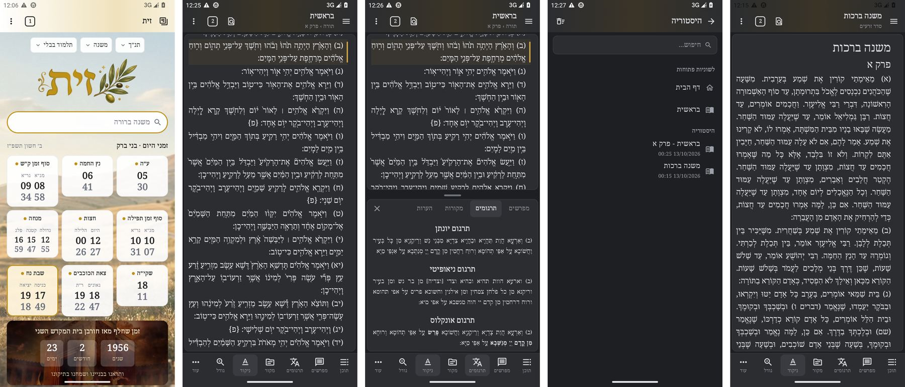
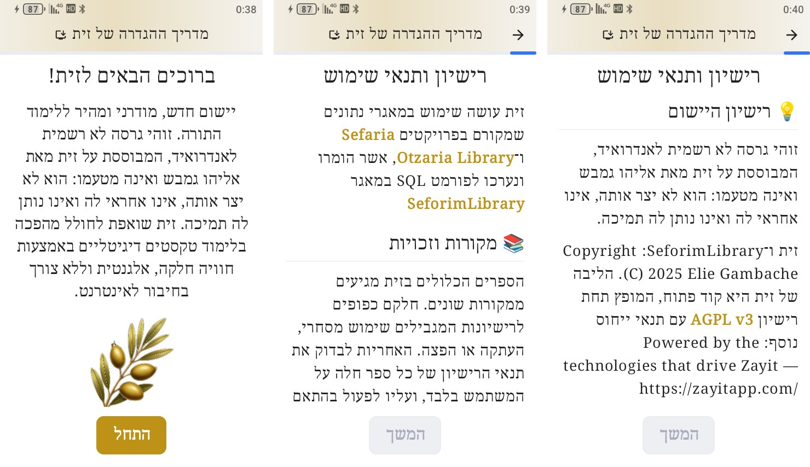
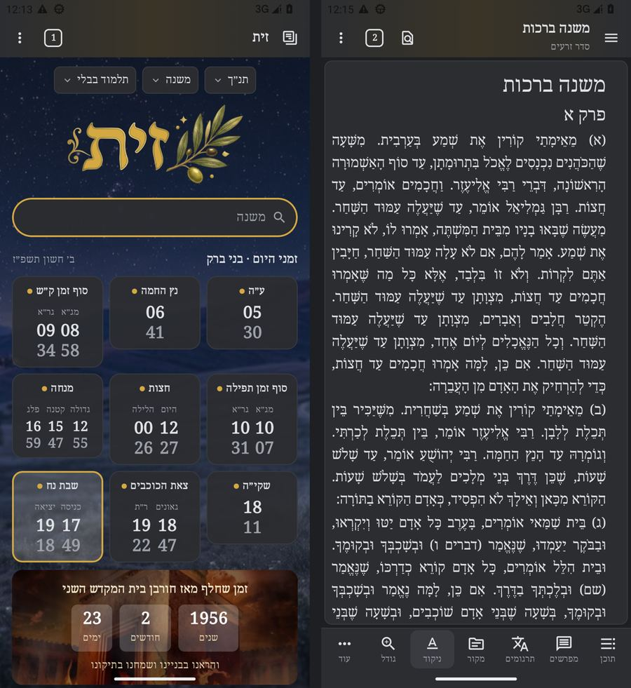

# Developing Pardes, the Android app based on Zayit

This file records where the Android port stands and how it is worked on. It is for whoever picks it up next, person or agent. Build steps are in [../README.md](../README.md), and the screen-by-screen design is in [../DESIGN.md](../DESIGN.md). Claude Code sessions also get the `zayit-android` skill (`.claude/skills/zayit-android/`). It has the scripts for the SDK, the emulator, screenshots and desktop comparison, plus a list of pitfalls that were already solved.

## Goal and constraints

- **Target:** Android 8.0 and later (minSdk 26; 33 up to 0.3.1, then 30), phones down to the 3" Unihertz Jelly Star, and tablets. Most testing is on Android 13 (the API 33 emulator and the Jelly Star); what differs on 8 to 12 is in [Android 8 to 12](#android-8-to-12).
- **Parity with desktop Zayit 0.6.11:** the same screens, wording (except the authorship texts, see below), behaviour and data. Desktop is the reference whenever something is unclear. The base was 0.6.1 until 2026-10-20, then 0.6.7 until 2026-10-26 and 0.6.10 until 2026-10-28; [PARITY.md](PARITY.md) › Later desktop releases records each change of 0.6.2 to 0.6.11 as ported, already present, not applicable or a deliberate difference.
- **Own app, based on Zayit:** Pardes is not an app by Zayit's author. User-facing text says Pardes is based on Zayit by Elie (Elyahou) Gambache (AGPL-3.0), who did not make it, is not responsible for it and does not support it. His copyright, licence and §7b attribution notices are kept; the porter is not named, and this repository is linked only as Pardes's AGPL source (the כללי header, אודות, תנאים). Where desktop's wording says who made the app (the welcome step, the settings header, About, the terms), Android's differs on purpose.
- **Offline, including search:** the app uses the desktop library and the desktop Lucene index. There is no server.
- **Shared code:** desktop code is reused unchanged where it compiles, and desktop sources are never edited for Android.

## Status

The app was rebuilt against the real desktop 0.6.1 sources in four waves on 2026-10-13, brought to desktop 0.6.7 on 2026-10-20, to 0.6.10 on 2026-10-26 and to 0.6.11 on 2026-10-28; [PARITY.md](PARITY.md) tracks every gap.

| Area | State |
|---|---|
| Engine and data | SeforimLibrary `4f07145`, desktop 0.6.11's (the repository's `SeforimLibrary` submodule, shared with the desktop build). Lucene search byte-identical to desktop 0.6.1 on a test library, plus 0.6.7's found-line range (c3190c4) and 0.6.11's forms budget for long queries (0749fbd). Desktop zmanim engine and city table. Incremental (delta) library updates. |
| Shell | Per-tab state, session restore, workspaces, pinned and reopenable tabs, history and favourites in desktop's `user_settings.db`, deep links, keyboard shortcuts. |
| Home and tools | Desktop widget grid, plus the tools ported from 0.6.1 (0.6.7 to 0.6.10 changed only desktop's 3D rendering there; the 0.6.2 tefila fix and 0.6.8's Temple counts are ported). |
| Search | 0.6.10 smart bar, typed references, in-book search, author scope, category tabs, grouping by book, knowledge panel, author page, tablet preview (0.6.1's, with the 0.6.2 search fixes 2126c238, 90552dbc and 51463d23 and the 0.6.5 author scope 1723de06 and 9e3d19a8). |
| Reader | Find in page over the whole book, range selection, highlights and notes, commentaries as desktop, the places that refer to a line (מראי מקומות) and its sources as search results (0.6.11), alt TOC, diacritics per category, shnayim mikra mode. |
| Settings and onboarding | Desktop keys and pages, database update flow, desktop fonts, desktop-compatible backup. The app updates itself from its GitHub releases (badge, dialog, Settings › כללי banner). |
| Devices | Built for 240dp phones (Jelly Star), normal phones and tablets (desktop layout from 840dp, search split from 1000dp). |
| Testing | Waves 1–4 compiled, R8-built and gated against API 33. The waves after the first Lucene build still need a full emulator and device pass. |

## Parity checklist

[PARITY.md](PARITY.md) lists every known difference from desktop, found by comparing it with the real 0.6.1 sources, and what each desktop release since changed (up to 0.6.11). It is the to-do list for this port. Tick items as they land.

## Screenshots

Phone (Pixel 6 size): home, reader, targum pane, history, dark reader.



Onboarding on the Jelly Star (the desktop first-run flow): the welcome step and the licence step, top and the app's own licence. Both say Pardes is based on Zayit by Elie (Elyahou) Gambache, who did not make it and is not responsible for it. (The images are from before the rename to Pardes.)



Dark theme.



## How the work is done

1. **Find the desktop behaviour in code.**
   - UI: `SeforimApp/src/jvmMain/.../features`. Since the merge of 2026-10-28 the repository's `SeforimApp/` is desktop 0.6.11 (0.6.10 from 2026-10-26, 0.6.7 from 2026-10-20); the tags `v0.6.1`, `v0.6.7`, `v0.6.10` and `v0.6.11` (fetched from https://github.com/kdroidFilter/zayit) show upstream's exact files and what changed in between.
   - Strings: `SeforimApp/src/commonMain/composeResources/values/strings.xml`.
   - What a screen looks like: run the released 0.6.11 headless and screenshot it (the skill's `desktop-start.sh`).
2. **Port it** under `app/src/androidMain/kotlin/.../android/`, and say in a KDoc which desktop class each file mirrors.
3. **Build** `./gradlew :app:assembleRelease` and install it on the API-33 emulator, and on the older ones (API 26, 28 and 30) when the change touches a platform API ([Android 8 to 12](#android-8-to-12)).
4. **Screenshot** at phone, Jelly Star (`wm size 480x854`, density 320) and tablet (`wm size 1920x1200`, density 240: 1280dp) sizes. Compare side by side with desktop and fix the differences.
5. **Commit** as `androidApp: <change>`.

## Working on Windows

The port was started in a Linux cloud container, and it also builds and runs on a Windows PC. What differs:

- **JDK.** Gradle must run on JDK 21 (see the README). Android Studio's bundled runtime is enough:
  ```bash
  export JAVA_HOME="/c/Program Files/Android/Android Studio/jbr"    # Git Bash
  ./gradlew :app:assembleRelease
  ```
- **Checkout under a non-ASCII path** (for example a Hebrew folder name). The Android Gradle plugin refuses to configure the build unless it gets `-Pandroid.overridePathCheck=true`, or that line in `~/.gradle/gradle.properties`. With it, the build, R8 and the scripts work from such a path.
- **SDK.** `local.properties` takes forward slashes: `sdk.dir=C:/Android/android-sdk`. Gradle downloads a missing platform or build-tools package by itself when the SDK licences are accepted.
- **Line endings.** `.gitattributes` keeps `*.sh` and `gradlew` on LF, so they run in Git Bash and WSL whatever `core.autocrlf` says.
- **API 26 gate.** `lucene-android/check-min-api.sh <jar>` runs from Git Bash after any build of `androidApp`: it dexes with the D8 inside AGP's builder jar in the Gradle cache (a newer build-tools D8 backports more and would hide missing methods) for the app's minSdk, and traces against `platforms;android-26` when it is installed.
- **Memory.** On a PC with 8 GB of RAM the R8 step alone can take half an hour, and the emulator does not fit next to a running build. Stop the Gradle daemons (`./gradlew --stop`) before starting the emulator.
- **Emulator.** With Hyper-V/WHPX the API 33 x86_64 image is hardware-accelerated, so the cloud container's software-emulation waits do not apply.
- **Desktop reference.** The installed desktop app keeps its library in `%APPDATA%\io.github.kdroidfilter.seforimapp\databases`. That folder is the default source of `tools/push-desktop-library.ps1`.
- **Native code.** `app/src/androidMain/cpp` builds `libpardes_multiplex.so` (SQLite's `test_multiplex.c` as a loadable extension, with the 3.49.1 headers) with CMake 3.22.1 and NDK 27.3.13750724. Gradle installs a missing NDK when the SDK licences are accepted. The extension calls only the routines of the SQLite that loads it: requery `sqlite-android` 3.49.0, published on JitPack only (`settings.gradle.kts` restricts that repository to `com.github.requery`).
- **Transfer script.** adb.exe reads its standard input as text, so a stream through `adb shell -T` stops at the first 0x1A byte. `tools/push-desktop-library.ps1` therefore pushes each file to `/data/local/tmp` and copies it into place on the phone, where the `.sh` streams it. Test changes to the `.ps1` on Windows, not with pwsh on Linux. Windows 11's "Run with PowerShell" runs `powershell -file` under the user's execution policy, so it refuses a downloaded `.ps1` ("is not digitally signed" under RemoteSigned, nothing at all under the default Restricted); `tools/push-desktop-library.cmd` runs it with `-ExecutionPolicy Bypass` and pauses at the end, and is what users double-click.

## Signing

Local debug and release builds are both signed with `androidApp/debug.keystore` (the usual debug credentials: store and key password `android`, alias `androiddebugkey`). It is in the repository on purpose: every machine then produces the same signature, so a build from a cloud session and a build from a PC install over each other without uninstalling, which would delete the library on the phone. The key is public, so it is only fit for development builds.

Published releases are signed with Pardes's own key, which only the repository's secrets hold (`.github/workflows/android-release.yml` checks the APK's certificate, `RELEASE_CERT_SHA256`). A release and a development build therefore cannot be installed over each other. The in-app updater relies on this: it installs only an APK signed with the installed app's own certificate, and a development build (whose certificate is not the release one) looks for no update at all.

## Testing the app update

A development build can run the whole update on a device or an emulator from a test feed instead of GitHub:

1. Build the build to update from (it must be at least the installed `versionCode`) and a build to update to, with a higher `versionName` and a `versionCode` not lower. On a phone that keeps a real library, keep `versionCode` where it is: a higher one would stop later builds from installing over it without uninstalling, which deletes the library.
2. Copy the target APK into the app's private files, e.g. `files/app-update-test/pardes-android-0.3.1-99.apk`, and write `files/app-update-test-feed.json` in `releases.json`'s shape, one release with the tag `android-0.3.1-99`, the APK's `name`, its `size`, `"digest": "sha256:<sha256>"` and `"browser_download_url": "file:///data/user/0/io.github.efrul.pardes/files/app-update-test/pardes-android-0.3.1-99.apk"`. Optionally `files/app-update-test-changelog.md` (CHANGELOG.md's format) for what is new. The release build type is not debuggable, so `run-as` cannot write there: use `adb root` on an emulator image that allows it, or `su` on a rooted phone, then `chown` the files to the app's uid and `restorecon -R` the folder.
3. Stop the app (`am force-stop`: the check runs once per process) and start it. It finds the version at start (the snackbar once per version: remove `announced_version` from `shared_prefs/app_update.xml` to see it again, and the badge), downloads (copies) and checks the APK; the first time the banner asks for "install unknown apps" ("פתח הגדרות"); then Android installs it, usually with no question. A release-key APK in the feed shows the refusal path ("אינו חתום במפתח של פרדס המותקן"); the real API list (`curl https://api.github.com/repos/efrul/Pardes/releases`) as the feed checks the parsing.
4. Remove the three test files afterwards: while the feed is there, the build keeps offering its version. Without the feed the build drops what it downloaded at its next start.

The feed is read only by a build that is not signed with the release key, and its `file:` URLs only inside the app's files.

## Android 8 to 12

minSdk is 26 (Android 8.0, since 2026-10-18; 30 earlier that day, 33 up to 0.3.1). Android 11 and later must behave exactly as with minSdk 30, and Android 12 and later exactly as with minSdk 33 (except D8's backports, below): every platform call newer than API 26 sits behind a `Build.VERSION.SDK_INT` check with a fallback (the launcher widgets are off by a resource qualifier, `values-v31`). API 26 is the hard floor: Lucene needs `java.nio.file`, `java.time` and MethodHandle's `invoke-polymorphic`. Lint's NewApi check is not enough on its own. It missed `InputStream.readNBytes(int)` (API 33) and `RemoteViews(Map)` (API 31), probably because its Kotlin frontend cannot read Kotlin 2.4 metadata, and at minSdk 26 AppUpdater's `SessionInfo.isStaged`/`isCommitted` (API 29). Look a new call up in the SDK's `platforms/android-36/data/api-versions.xml` (its `since`), and check the release dex too: `lucene-android/gate/DexApiLevels.java levels <api-versions.xml> 26 <empty jar> <dex dir>` lists every reference above the level (460 at 26 on 2026-10-18), but R8 moves calls to newer APIs into synthetic `$$ExternalSyntheticApiModelOutline` classes, so find their callers in `dexdump -d` and map them back with `mapping.txt`. On 2026-10-18 every app reference above 26 was guarded, in widget code (off below 31), in androidx/Compose, or in lucene-android's API 33 class.

- **Emulators.** `system-images;android-30;google_apis;x86_64` (google_apis like the API 33 image, so `adb root` works), in the PC's SDK (`C:\AndroidSDK`) as AVD `Android11_Emulator`, beside `Android13_Emulator`; `system-images;android-26;google_apis;x86_64` and `android-28` (google_apis too), as AVDs `pardes26` and `pardes28` in the cloud container (under TCG API 26 boots in under a minute, 28 in about 7). The API 33 emulator and the Jelly Star stay the main test devices; run 8.0, 9 and 11 for changes to platform calls, the updater, the widgets, the system bars, search, or SQL that binds a list or writes the user database.
- **Launcher widgets** are off below Android 12: they are drawn with RemoteViews API from 12 (`setColorInt`, `setViewLayout*`, a RemoteViews per size), so on 8 to 11 the launcher lists none of Pardes's widgets. The widgets of the app's own Home screen are not affected; the temple widget's animated picture (`ImageDecoder`, `AnimatedImageDrawable`) needs Android 9, and Android 8 shows the still one.
- **SQLite.** Android 8.0 ships SQLite 3.18.2, 8.1 3.19.4, 9 and 10 3.22.0, 11 3.28.0, 12 and 13 3.32. Below 3.32 one statement takes at most 999 bound parameters, so below Android 12 a list of ids bound with `IN ?` goes in chunks (`SqlVariableLimit`; `LineConnections` binds 400 per query): a longer list fails with "too many SQL variables" there only. Below 3.24 there is no UPSERT: below Android 11 favourites and visit history run `app/src/androidMain/sqldelight-user-legacy/.../UpsertLegacy.sq` (an UPDATE, then an INSERT … WHERE NOT EXISTS, in one transaction; `FavoritesStore`, `HistoryStore`), and desktop's `.sq` files stay untouched. `VACUUM INTO` needs 3.27: below, `UserDataBackup` checkpoints the log and copies the file under the write lock. `user_settings.db` is in rollback-journal mode, not WAL (`UserDataStore` does not turn WAL on; seen on the 8.0, 9 and 13 emulators), so there the checkpoint finds no log and the write lock alone keeps the copy whole. The SQLDelight dialect is 3.24, so it does not catch what 3.18 to 3.22 lack. A patch migration written with 3.29–3.32 syntax would fail on 11 only.
- **The bundled SQLite below Android 9.** There Android's cursor window cannot be widened (`CursorWindow(String, long)` is API 28, and SQLDelight applies `windowSizeBytes` only from 28), and book rows reach 4.25 MB, so every library database is opened through requery's SQLite 3.49 (`SplitDatabase.usesBundledSqlite`, the one predicate every opener asks: `LibraryStore` and `SplitDatabase.openReader`). A split (FAT32) database uses it on any version, as before. It has no 999-parameter limit, so test SQL that binds a list with a single-file library on Android 9 to 11.
- **Incremental library updates** need Android 11 (the patches need SQLite 3.24): below, `DbDeltaUpdateService.deltaRefusal` refuses them (`DeltaStrings.androidTooOld`), and the database update flow offers the full download.
- **Foreground services** start with `ServiceCompat.startForeground`: the typed `startForeground` is API 29.
- **App update.** Below Android 12 Android asks to confirm every update, since `UPDATE_PACKAGES_WITHOUT_USER_ACTION` exists only from 12. Android 11 ends an app whose "install unknown apps" permission is turned on, so after "פתח הגדרות" the update goes on in a new process: AppUpdater remembers the wait (`awaiting_install_permission`), and the new process reopens the dialog and installs the checked APK by itself (only the first shell start of a process takes the flag up). Checked on the API 30 emulator, 2026-10-18: the app ended at the toggle, Back reopened the dialog and Android's "Install" confirmation, and 0.3.1 installed with Pardes as its installer. Below Android 9 the certificates come from `GET_SIGNATURES` and `PackageInfo.signatures` (those Android verified), the version from `PackageInfoCompat.getLongVersionCode`, and there is no lineage (v3 key rotation is Android 9's). Below 10 `SessionInfo.isStaged`/`isCommitted` are missing (API 29): no session is staged there, and a committed session is a sealed one (`isSealed`, API 26).
- **Vector icons.** Android 11's Skia moves a relative moveTo that follows a close() from the contour's last point instead of its start, so Material Symbols paths ("...Zm-280-80v440...") were drawn askew. `VectorPathCompat` turns those moves absolute below Android 13, and `build-logic` (plugin `pardes.compose-vector-moves`, AGP's instrumentation API) makes Compose's `ImageVector.Builder.addPath`/`addGroup` call it, for every icon whoever built it.
- **D8 backports.** For a method newer than minSdk that it knows, D8 puts its own code in the APK instead of the platform call, with no SDK_INT check, so Android 12 and 13 run it too. That is the one place they no longer run what they ran with minSdk 33. In lucene-android it covers `List/Set/Map.copyOf`, `String.isBlank`, `Predicate.not` and `Math.multiplyExact(long,int)`, and at minSdk 26 also what came with API 30 (`List.of`, the `Objects.check*` index checks), so Android 11 runs D8's code for those too, and the covariant `ByteBuffer` overloads (API 29), which D8 rewrites to their `Buffer` forms. The results are the same for what Lucene passes; only reflection could reach the platform method, so it stays.
- **R8 and lucene-android.** R8 once moved `AndroidCompatApi33`'s VarHandle calls into `GroupVIntUtil`; Android 11's verifier rejected that class and search failed. `proguard-rules.pro` keeps the class, and `lucene-android/check-release-dex.sh` (run by the release workflow) fails if a VarHandle call leaves it.
- **Lucene on Android 8 to 10.** The ART of Android 8 and 9 creates a constructor MethodHandle's instance from the type `asType` gave the handle, so Lucene's `AttributeFactory` (`findConstructor(...).asType(AttributeImpl)`) tried to instantiate the abstract `AttributeImpl` and every search failed (`InstantiationException`, found on the 8.0 and 9 emulators; no gate sees it). lucene-android rebuilds `AttributeFactory` from 10.5.2's source: below API 30 (`AndroidCompat.API_30`, off with `forceFallbacks` too; Android 10 was not checked, so it takes the same path) the reflected constructor makes the instance; from 11 the class runs as before.
- **Navigation bar** below Android 10: `enableEdgeToEdge` paints it with a scrim of the system's night mode, not the app's, so `SystemBarsHost` and `DialogSystemBarsOver` set `navigationBarColor` to androidx.activity's light or dark scrim, matching the app's background. `windowLightNavigationBar` (API 27) is set in the `values-v27/` and `values-night-v27/` themes; on 8.0 the splash window's white navigation icons get the dark scrim instead (`values/themes.xml`).
- **APK.** `dex.useLegacyPackaging = false` keeps `classes.dex` stored (uncompressed) below minSdk 28, as it was.
- **Transfer scripts** (`tools/push-desktop-library.sh`/`.ps1`): stock Android 8.x has no awk, so the phone's file sizes are summed on the computer and `/proc/mounts` is read there. Below Android 11 the phone's shared storage (sdcardfs) refuses `chmod` (EPERM, checked on the 8.0 emulator) and needs none, so there `chmod` is only tried.
- **Copying the library from a computer.** Android 11's `adb shell` is not in the `ext_data_rw` group (Android 12 added it), so it cannot read or write `Android/data/<app>/`: the transfer scripts cannot copy into the app's folder there. They read the API level first and stop at once with a message saying so (unless adb runs as root and can list `Android/data`). On 11, install from the bundle files in the app instead ("התקנה לא-מקוונת"). Android 8 to 10 do not have that limit: their sdcardfs gives the shell `sdcard_rw` (checked with the scripts on the 8.0 and 9 emulators, without root), and the files it writes there belong to the app; the scripts' stop applies on Android 11 only.

## Semantic search

Pardes desktop's own semantic search (חיפוש לפי משמעות; `SEMANTIC_SEARCH.md` and `docs/SEMANTIC_PLAN.md` at the repository's root, and the `pardes-semantic-search` skill): Dicta's open model, int8 ONNX, a Lucene HNSW index of the library's lines, fused with the search by words. Android runs the same model and the same pack as desktop; [PARITY.md](PARITY.md) › Pardes desktop's semantic search says what was ported and what differs.

- **Code.** Desktop's files that compile here are built unchanged (`syncDesktopSemantic` in `app/build.gradle.kts`); the rest are Android variants with desktop's packages and names in `search/semantic/` and `search/semantic/pack/`, each with a header listing its changes. App side: `search/SearchService.withSemanticSearch`, `search/SemanticSearchSupport` (64-bit only), `search/SemanticPackManager` with its foreground service, `ui/settings/SemanticPackSection`, and the reader's smart find (`findSmartMatchesInBook`, the find bar's toggle).
- **ONNX Runtime 1.20.0**, not desktop's 1.17.1: 1.20.0 is the first whose Android libraries are aligned to 16 KB pages (1.17.1 to 1.19.2 are aligned to 4 KB, which a phone with 16 KB pages refuses). Its 32-bit libraries are left out of the APK (`packaging.jniLibs.excludes`). R8 keeps `ai.onnxruntime.**`: its JNI finds the Java classes by name, and the AAR has no keep rules of its own.
- **The pack** is two folders beside `seforim.db`: `pardes-model/` (the 170 MB model and its tokenizer) and `pardes.vec.lucene/` (2.6 GB), 2.8 GB together. Settings › ניהול נתונים › חיפוש לפי משמעות downloads the newest `semantic-*` release for the library's `release_info.txt` (2.04 GB, read straight into `.pardes-semantic-staged/` as it unpacks; it needs about 3.3 GB free) or imports the files picked together; `PendingSemanticPack` swaps the folders in at the next start. The transfer scripts copy both folders when the desktop library has them. A full library install deletes the vector index (it belongs to the old library) and keeps the model.
- **Testing on the emulator.** The pack's index covers the whole library, so a test library needs the full `pardes.vec.lucene/` beside it; the lines of a subset are found by meaning only when they are in its `seforim.db`. Copy it with `tools/push-desktop-library.sh --source <dir>` (no root). `./gradlew :app:testDebugUnitTest` runs desktop's semantic tests on the port. On the device, `./gradlew :app:assembleDebug :app:assembleDebugAndroidTest`, install both APKs, then `adb shell am instrument -w -e class io.github.kdroidfilter.seforimapp.features.search.semantic.HfTokenizerParityTest io.github.efrul.pardes.test/androidx.test.runner.AndroidJUnitRunner` (desktop's parity fixtures, from `SeforimApp/src/jvmTest/resources/semantic/`) and `...SemanticReferenceTest` (the pack's reference queries, with timings and memory in logcat `PardesSemanticTest`; skipped without the pack).

## Decisions and why

- **Separate Gradle build** (`androidApp/`): the desktop build stays untouched and builds without the Android SDK.
- **Compose redraw instead of the desktop UI:** desktop uses Jewel and desktop-only window APIs. The Android UI copies its look (Islands colours, fonts, gold accent) and adapts the layout to touch and small screens.
- **minSdk 26** (Android 8.0, since 2026-10-18): at first 33, for the user's own Android 13 phone (up to 0.3.1); 30 after it, so that Android 11 and 12 phones can run the app too; 26 later the same day, for older phones and tablets and for kosher phones. StatCounter (September 2026, Israel): minSdk 28 adds 3.44% of Android page views, mostly Android 10, and 9.7% of tablets; 26 adds 0.43% more, and 4.2% of tablets. StatCounter cannot see browserless kosher phones and players. Platform calls newer than 26 are guarded with a fallback rather than dropped, so Android 11 and later lose nothing against minSdk 30, 12 and later nothing against 33, and everything that needs newer Java APIs is patched or avoided rather than raising minSdk (see [Android 8 to 12](#android-8-to-12)).
- **Lucene on the phone:** the same index and engine as desktop means the same results, no on-device indexing and no server. Lucene 10.x needs JDK APIs that Android lacks, so `lucene-android/` patches lucene-core, and `check-min-api.sh` (AGP's D8 for minSdk 26, then TraceReferences against the API 26 and 33 platforms) guards it.
- **Library on a memory card** (since 2026-10-16): in the app's own folder on the card, not a folder the user picks, so no storage permission (all-files access) is needed. A FAT32 card gets the database in multiplex chunks rather than a refusal, because Android formats cards of 32 GB and less as FAT32. From Android 9 on only a split database uses the bundled SQLite: every other library keeps Android's, so nothing changes for it (below 9 every library uses it, see [Android 8 to 12](#android-8-to-12)).
- **Updating the app from GitHub releases** (since 2026-10-17): the releases are read as the download site reads them (the GitHub API's list, else the site's `releases.json`), with no server of our own, and compared by `versionName` (the tag carries it, not `versionCode`). The APK is trusted for its signing certificate, not for where it came from: the app trusts user CAs (for filtering proxies), so whoever holds one could change the list and the file alike; the sha256 only proves the download is whole. PackageInstaller sessions rather than an `ACTION_VIEW` of the file: no FileProvider, and with `UPDATE_PACKAGES_WITHOUT_USER_ACTION` the app replaces itself without a question once the user has let it install apps (from Android 12; Android 8 to 11 ask every time).
- **R8 release builds,** even for testing: the debug APK is many times larger and slow on a software emulator.
- **Own name, icon and applicationId:** Pardes (פרדס), an icon of its own (the word in gold on olive green) and `io.github.efrul.pardes` since 2026-10-15, at the request of Zayit's author (before it, "זית לאנדרואיד" as `io.github.efrul.zayit`, and earlier test builds in the original author's namespace). The code's namespace and package names stay `io.github.kdroidfilter…`, as in desktop. Test builds from before the change (never distributed) are a different app to Android, with their own library.

## Known gaps / ideas

- Incremental updates on a library split for a FAT32 card: the delta code opens the database with Android's SQLite. Porting it to the bundled SQLite (requery's API mirrors Android's) would lift that.
- Launcher widgets need Android 12, so they are off on 8 to 11. A drawing path below 12 (colours set with `setInt` by day or night, fixed layouts, one RemoteViews for every size) would bring them back.
- Year cycle tool: 2D rendering only.
- Dictionary tool: headword match only.
- App updates are found only while the app runs (at start, or in Settings): there is no background check (WorkManager) or notification for a new version.
- No Play Store packaging, and no app bundle with split APKs. A store listing would also need text that says Pardes is based on Zayit by Elie (Elyahou) Gambache and is not on his behalf.
