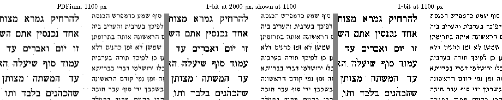

<div dir="rtl">

# מהירות הסריקה בגמרא: מהטקסט לעמוד בשבריר שנייה (14.11.2026)

בקשה 42 של [DESKTOP_STAGE2.md](../DESKTOP_STAGE2.md), ובלשון של 14.11: "אני רוצה תצוגה הכי מהירה, במיוחד בדפי גמרא, שהמעבר בין טקסט לדף יהיה בשבריר שניה. בדוק אולי כדאי לחתוך כל עמוד למשהו נפרד".

- **הבדיקה הראשונה של 42** (13.11, בתוכנית) מדדה את הציור של עמוד אחד.
- **כאן נמדד המעבר כולו,** מהלחיצה על "סריקה" עד שהעמוד על המסך. הקוד הוא של הענף `claude/sleepy-lovelace-k4c21z` (`5eaedfb`, בנייה 47).
- **ונבדק מה מקצר אותו:** איפה הזמן הולך, מה נותן חיתוך לקובצי PDF ומה חיתוך לתמונות, ואיך מציגים מהר.

## בקצרה

- **היום:** מהלחיצה עד שהעמוד מוצג עוברות 0.3 עד 0.7 שניות, ובשני עמודים זה ליד זה עד שנייה.
  - כך בכל מעבר, לא רק בראשון: הקובץ נסגר כשחוזרים לטקסט, ונפתח מחדש במעבר הבא.
  - המעבר הראשון בהפעלה ארוך יותר, שנייה ויותר: הקובץ נקרא מהדיסק, ו-PDFium נטען.
- **רוב הזמן לא הולך על הקובץ, אלא על הציור של העמוד:**
  - PDFium מפענח בכל ציור את כל התמונה הסרוקה מחדש, 30 עד 100 ms לעמוד.
  - מציג ה-PDF של Nucleus מוסיף על זה המתנה קבועה של 100 ms לפני כל עמוד.
  - הוא מצייר קודם תצוגה מקדימה באיכות נמוכה, שעולה כמעט כמו הציור המלא.
  - הכול עובר בתור אחד, שבו העמודים הבאים מצוירים לפני העמוד שעל המסך.
- **קובץ PDF לכל עמוד לא עוזר:** הוא חוסך את הפתיחה (16 עד 26 ms בקבצים כאן), ולא נוגע בציור.
- **תמונה לכל עמוד עוזרת מאוד:**
  - העמוד מוצג 29 עד 46 ms אחרי הלחיצה.
  - אם העמוד הנוכחי פוענח מראש בזמן קריאת הטקסט: 17 עד 27 ms, כלומר בפריים הבא.
  - זה פי 10 עד 30 מהיום.
- **ההמלצה:**
  - פרדס יחתוך ברקע את הסריקה של מסכת לתמונה לכל עמוד, במחשב של המשתמש, בפעם הראשונה שהסריקה שלה נפתחת.
  - הוא יצייר את העמודים מהתמונות בעצמו, בלי המציג של Nucleus.
  - בזמן קריאת הטקסט הוא יחזיק את העמוד הנוכחי מוכן.
  - שום סריקה של אוצריא לא מופצת: החיתוך קורה רק אצל המשתמש. החבילה מדפוס וילנא (41), כשתבוא, תגיע כבר חתוכה.

## מה הורץ

- **המכונה:** מכונת הענן, 4 ליבות, 15 GB זיכרון, בלי כרטיס גרפי.
- **הסריקות:**
  - הסריקות של אוצריא לא היו זמינות לסשן הזה: המאגר של צורת הדף, שבו הן שמורות, לא נפתח לו, וארכיון האינטרנט חסום ברשת של הענן.
  - לכן נבנו חמש מסכתות לבדיקה, 160 עמודים כל אחת ([`tools/make_pages.py`](tools/make_pages.py), [`tools/make_pdfs.py`](tools/make_pdfs.py)).
  - כל עמוד ערוך כדף של וילנא: גמרא באמצע, רש"י ותוספות בצדדים, הערות בשוליים, כותרת. הטקסט אמיתי (ברכות ב.), בגופני culmus.
  - כל עמוד הוא תמונה בשחור-לבן, 2,950 על 4,490 פיקסלים (300 DPI), עם רעש של סריקה.
  - הבדיקה של 13.11 מדדה כ-75 ms לעמוד בקובצי אוצריא עצמם. זה מתאים לקובץ ה-JBIG2 הרגיל כאן (77 ms), ולכן הוא העיקרי בבדיקה.

| הקובץ | הקידוד | הגודל | לעמוד |
|---|---|---|---|
| `jbig2-sym` | JBIG2 עם מילון סימנים משותף, כמו בארכיון האינטרנט | 3.9 MB | 24 KB |
| `jbig2-gen` | JBIG2 רגיל | 16.3 MB | 102 KB |
| `g4` | CCITT G4, הקידוד של הפקס | 25.6 MB | 160 KB |
| `jpeg150` | JPEG באפור, 150 DPI | 86.6 MB | 541 KB |
| `jpeg300` | JPEG באפור, 300 DPI | 181.8 MB | 1,136 KB |

- **הכלים:**
  - [`PdfiumBench`](tools/PdfiumBench.java): כל צעד של הספרייה של Nucleus לחוד, באותן קריאות שהיא עצמה עושה. פתיחה, טעינה של עמוד, הקישורים שלו, תצוגה מקדימה ברבע רוחב, וציור מלא ב-1,100, 1,600 ו-2,048 פיקסלים.
  - [`SkiaBench`](tools/SkiaBench.java) ו-[`CutPages`](tools/CutPages.java): עמוד שצויר ב-PDFium נשמר כתמונה בכמה פורמטים ומפוענח שוב ב-Skia, כמו שהממשק יעשה. וכמה עולה לחתוך מסכת.
  - [`ScanSwitchBench`](../../SeforimApp/src/jvmTest/kotlin/io/github/kdroidfilter/seforimapp/features/bookcontent/daf/ScanSwitchBench.kt): תצוגת הסריקה כמו שפרדס בונה אותה (`PdfReaderState` של הספרייה ו-`PdfPageList` של פרדס), בסצנה של Compose ש-Skia מצייר.
    - מרגע המעבר נקרא פריים כל 8 ms, עד שהעמוד נשאר קבוע.
    - שש פעמים לכל דרך, ונלקח החציון.
  - **בתוכנה עצמה:** שורות מדידה זמניות ב-`DafScanButton` וב-`DafScanView`, שלא נשמרו. ברכות, עם אוצריא מדומה שהקובץ שלה הוא `jbig2-gen`.
- **ההרצה:** [למטה](#איך-מריצים).

## מה נמצא

### 1. מה קורה היום במעבר

1. הלחיצה מדליקה את `scanView`, ו-`BookContentView` מחליף את הטקסט ב-`DafScanReader`.
2. **מציאת הקובץ:** `DafScans.of` שואל את מסד המשתמש ומחפש בתיקייה של אוצריא, ואז `linked` שואל את המסד שוב.
3. **פתיחת הקובץ** (`ScanPages`):
   - נוצר `PdfReaderState` חדש.
   - כל הקובץ נקרא לזיכרון (`readBytes`), מועתק לזיכרון של PDFium ונפתח.
   - במקביל נמצא מהמסד העמוד של השורה שבראש הלשונית (`amudOfLine`).
4. **רשימת העמודים** (`ScanList`): תוכן העניינים של המסכת נקרא מהמסד, ואחריו מוצגת `PdfPageList`.
5. `PdfPageList` שולחת מיד לציור את העמודים של שתי השורות הבאות (`prefetch`).
6. **לכל עמוד שעל המסך,** ה-`PdfPage` של הספרייה:
   - מבקש את הגודל שלו ואת הקישורים שלו (`linksEnabled` דלוק כברירת מחדל).
   - רק 100 ms אחרי שהגודל ידוע, מצייר תצוגה מקדימה ברבע רוחב, ואחריה את העמוד המלא.
   - כל אלה עוברים בתהליכון אחד של PDFium, בסדר שבו נשלחו. לכן העמוד שעל המסך מחכה לעמודים הבאים.
7. **בחזרה לטקסט** `DafScanReader` יוצא מהמסך. הקובץ והעמודים שצוירו (עד 64 MB) נזרקים, והמעבר הבא מתחיל שוב מצעד 2.

### 2. בתוכנה: עד שרשימת העמודים מתחילה

נמדד בענן, בברכות, עם הקובץ `jbig2-gen` כקובץ של אוצריא ([`runs/app.txt`](runs/app.txt)). הזמנים הם מהלחיצה:

| | נמצא הקובץ | נמצא העמוד | נקרא הקובץ | נפתח | הרשימה מתחילה |
|---|---|---|---|---|---|
| המעבר הראשון בהפעלה | 52 ms | 103 ms | 846 ms | 1,260 ms | 1,261 ms |
| המעברים הבאים (חציון של 8) | 20 ms | 42 ms | 55 ms | 60 ms | 61 ms |

- **במעבר הראשון:**
  - קריאת הקובץ מהדיסק לקחה 0.8 שנייה. זה דיסק הרשת של הענן; בכונן SSD מקומי זה צפוי להיות עשרות ms.
  - הטעינה של PDFium עם הפתיחה לקחה עוד 0.4 שנייה.
- **אחרי שהרשימה מתחילה,** מגיע הציור של העמוד, וזה עיקר הזמן (סעיף 6).
- **לא נמדד בתוכנה:** הציור על המסך. בענן הוא עובר דרך llvmpipe, תוכנה שמחקה כרטיס גרפי, ולכן הוא נמדד בכלי לחוד.

### 3. PDFium: כמה עולה לצייר עמוד

ב-ms, חציון של 5 עמודים שלא צוירו קודם ([`runs/pdfium.txt`](runs/pdfium.txt)):

| הקובץ | פתיחה (קריאה והעתקה) | תצוגה מקדימה, 400 px | 1,100 px | 1,600 px | 2,048 px |
|---|---|---|---|---|---|
| JBIG2 עם מילון | 4 | 18 | 36 | 45 | 53 |
| JBIG2 רגיל | 16 | 60 | 77 | 87 | 98 |
| G4 | 26 | 33 | 45 | 57 | 64 |
| JPEG 150 DPI | 91 | 12 | 18 | 17 | 26 |
| JPEG 300 DPI | 242 | 30 | 44 | 55 | 71 |

- **אותו עמוד שוב עולה אותו דבר:** PDFium לא שומר כלום מעמוד אחרי שנסגר, ומפענח את כל התמונה מחדש בכל ציור.
- **התצוגה המקדימה עולה 40 עד 78 אחוז מהציור המלא:** כדי להקטין, צריך לפענח את כל התמונה בכל מקרה. כלומר, היא מאטה את העמוד ולא מקדימה אותו.
- **הטעינה של עמוד והקישורים שלו לא עלו כאן כלום,** כי בקבצים האלה אין שכבת טקסט. אם בקובצי אוצריא יש שכבת טקסט מזיהוי תווים, הקישורים יעלו עוד זמן לכל עמוד. זה לא נבדק.

### 4. קובץ PDF לכל עמוד

- **הקובץ:** העמוד הראשון של `jbig2-gen` לבדו, 0.1 MB.
- **הפתיחה:** 0.1 ms במקום 16.
- **הציור:** 75 ms ב-1,100 פיקסלים ו-88 ב-1,600, בדיוק כמו מהקובץ השלם.
- **המסקנה, כמו ב-13.11:** חוסך את הפתיחה ואת הזיכרון (100 KB במקום 16 עד 38 MB), לא את הציור.

### 5. תמונה לכל עמוד

עמוד שצויר ב-PDFium, נשמר ב-Skia ופוענח שוב ב-Skia. הזמנים ב-ms, חציון ([`runs/skia.txt`](runs/skia.txt)):

| הפורמט | 1,100 px: גודל | פענוח | 1,600 px: גודל | פענוח | שמירה, 1,600 px |
|---|---|---|---|---|---|
| PNG באפור | 405 KB | 4.4 | 633 KB | 8.0 | 55 |
| PNG ב-16 גוונים | 221 KB | 4.5 | | | |
| PNG בשחור-לבן | 61 KB | 3.3 | | | |
| PNG בשחור-לבן, 2,000 px | | | 141 KB | 10.5 | |
| PNG בצבע | 964 KB | 12.5 | 1,421 KB | 23.4 | 156 |
| WebP בלי אובדן | 579 KB | 35.3 | 946 KB | 61.5 | 320 |
| WebP 90 | 427 KB | 26.7 | 698 KB | 47.6 | 310 |
| JPEG 90 באפור | 664 KB | 8.0 | 1,112 KB | 14.0 | 41 |

- **PNG באפור הוא הטוב מבין מה ש-Skia יודע לכתוב.** WebP איטי בפענוח, ו-JPEG גדול יותר ומלכלך סביב האותיות.
- **שחור-לבן ברוחב המסך שובר את האותיות הקטנות** (ברש"י, מימין בתמונה). אבל שחור-לבן ב-2,000 פיקסלים, מוקטן ל-1,100, נראה כמו הציור של PDFium עצמו (באמצע):



- **הגדלים כאן של עמודים מדומים עם הרבה רעש.** בבדיקה של 13.11, על הסריקות של אוצריא עצמן, יצאו ב-1,100 פיקסלים 70 KB בשחור-לבן ו-240 KB ב-16 גוונים, קרוב לזה.
- **שחור-לבן ו-16 גוונים** נכתבו כאן בכלי חיצוני: Skia לא כותב אותם. לפרדס יידרש לזה כותב PNG קטן משלו.

### 6. המעבר כולו: מהלחיצה עד שהעמוד מוצג

ב-ms, חציון של 6 מעברים. העמוד ברוחב 1,100 נקודות, כמו בסריקה של פרדס ([`runs/switch-*.txt`](runs)):

| הקובץ | היום | היום, שני עמודים | הקובץ פתוח, העמוד צויר מראש | תמונה חתוכה | תמונה חתוכה, מפוענחת מראש |
|---|---|---|---|---|---|
| JBIG2 רגיל | 549 | 1,002 | 383 | 31 | 17 |
| JBIG2 רגיל, מסך 150% | 659 | 931 | 427 | 46 | 27 |
| G4 | 395 | 475 | 266 | 29 | 18 |
| JBIG2 עם מילון | 323 | 393 | 219 | 30 | 17 |

- **הדרכים:**
  - **"הקובץ פתוח, העמוד צויר מראש":** הכי טוב שאפשר עם מה שהספרייה של Nucleus מאפשרת היום. הקובץ נשאר פתוח מעל המעבר, והעמוד נשלח לציור (`prefetch`) בזמן שהטקסט מוצג.
  - **"תמונה חתוכה":** קובץ PNG לכל עמוד, נקרא ומפוענח ברגע המעבר.
  - **"מפוענחת מראש":** אותה תמונה, כבר בזיכרון לפני הלחיצה.
- **למה גם "הקובץ פתוח" נשאר איטי:** גם כשהעמוד כבר צויר, ה-`PdfPage` של הספרייה ממתין 100 ms, מצייר שוב את התצוגה המקדימה (היא לא נשמרת), ונעמד בתור אחרי העמודים הבאים. רק ציור של העמוד בידי פרדס מוריד את כל אלה.
- **על המסך האמיתי:**
  - בכלי, Skia מצייר על המעבד.
  - בכרטיס גרפי הציור עצמו זול יותר.
  - העלאת התמונה לכרטיס (6 MB באפור) מוסיפה כמה ms בפריים הראשון.

### 7. כמה עולה לחתוך מסכת

ב-ms לעמוד: ציור, המרה לאפור ושמירה כ-PNG ([`runs/cut.txt`](runs/cut.txt)):

| הקובץ | 1,100 px | 1,600 px | 2,000 px |
|---|---|---|---|
| JBIG2 רגיל | 115 | 152 | 208 |
| G4 | 83 | 126 | |
| JBIG2 עם מילון | 67 | | |

- **ברכות** (כ-125 עמודים): 8 עד 26 שניות של ליבה אחת, פעם אחת.
- **בבא בתרא** (כ-350 עמודים): 23 עד 73 שניות.
- **כל הש"ס** (5,422 עמודים), אם כל מסכת תיפתח: 6 עד 19 דקות של ליבה אחת, לאורך הזמן.
- **על הדיסק:** בשחור-לבן ב-2,000 פיקסלים כ-0.8 GB לכל הש"ס, ובאפור ב-1,600 כ-3.4 GB.
- **השמירה כאן היא PNG באפור, של Skia.** בשחור-לבן היא צפויה להיות זולה יותר, כי יש פי 8 פחות נתונים לדחוס.

## מה אני מציע

1. **תמונה לכל עמוד, נחתכת במחשב של המשתמש:**
   - כשהסריקה של מסכת נפתחת בפעם הראשונה, פרדס מתחיל לחתוך אותה ברקע, בתהליכון אחד.
   - הסדר: קודם העמוד הנוכחי והבא אחריו, ואחר כך כל השאר.
   - כל עמוד מצויר ב-PDFium ברוחב 2,000 פיקסלים ונשמר כ-PNG בשחור-לבן, כ-140 KB. ברכות כולה כ-20 MB.
   - **הקבצים נשמרים בתיקייה לכל מסכת,** עם טביעה של קובץ הסריקה (הנתיב, הגודל והתאריך שלו). קובץ אחר, או קובץ שהשתנה, נחתך מחדש.
2. **פרדס מצייר את העמוד בעצמו, בלי ה-`PdfPage` של Nucleus:**
   - רשימה משלו לסריקה של מסכת, כמו `PdfPageList`: עם הכותרות, שני עמודים זה ליד זה, המקשים וההגדלה.
   - התמונה של עמוד מפוענחת מחוץ לתהליכון של הממשק (4 עד 11 ms) ונשמרת בזיכרון קטן, כ-8 עמודים.
   - היא מצוירת מוקטנת, בהחלקה של Skia.
   - **בלי המתנה ובלי תצוגה מקדימה.**
   - עמוד שעוד לא נחתך מצויר מיד, ראשון בתור, ונשמר.
3. **העמוד הנוכחי מוכן עוד לפני הלחיצה:**
   - בזמן שהמסכת מוצגת כטקסט או כצורת הדף, ואם הסריקה שלה כבר חתוכה, העמוד שבראש הלשונית והבא אחריו מפוענחים לזיכרון. זה כ-10 ms בכל מעבר עמוד.
   - המעבר לסריקה מצייר אותם בפריים הבא (17 עד 27 ms, סעיף 6).
4. **קובץ ה-PDF נפתח רק כדי לחתוך:**
   - כשכל העמודים חתוכים, הסריקה מוצגת מהתמונות בלבד.
   - 16 עד 38 MB של הקובץ לא מוחזקים בזיכרון.
   - גם המעבר הראשון בהפעלה לא מחכה לקובץ ול-PDFium.
5. **החבילה מוילנא (41):** תיבנה כבר חתוכה, באותו פורמט, ותורד למסכת (20 עד 50 MB). כך היא מיידית מהפעם הראשונה, בלי PDFium בכלל.
6. **ספרי ה-PDF של המשתמש (28, 45):** אותו ציור, בלי המתנה ובלי תצוגה מקדימה, יאיץ גם אותם. לחתוך אותם אין צורך. זה צעד מאוחר יותר.

### המכשול: הספרייה לא נותנת את הציור עצמו

כדי לחתוך, פרדס צריך את העמוד המצויר עצמו. הספרייה של Nucleus נותנת רק את ה-`PdfPage` שלה, רכיב מוכן למסך, ו-`renderPage` שלה פנימי. ארבע דרכים:

- **עותק של הספרייה עם פונקציה ציבורית אחת, שמציירת עמוד לתמונה** (ההמלצה):
  - כמו העותק של חלון ה-Tao (`nucleus-fork/`). שינוי של שורות ספורות, אותן ספריות מקומפלות.
  - ובמקביל, לבקש מ-Nucleus עצמה להוסיף את הפונקציה, ולוותר על העותק כשתבוא.
- **קריאה לפונקציה הפנימית בהשתקה של שגיאת הקומפיילר:**
  - נבדק: זה מתקמפל, עם אזהרה שההתנהגות "לא מוגדרת ולא תישמר".
  - שביר: גרסה הבאה של הספרייה או של הקומפיילר יכולה לשבור את זה.
- **FFM של Java** (סופי ב-JDK 25, שעליו פרדס נבנה), ישר מול PDFium שהספרייה טוענת:
  - שליטה מלאה: פתיחה לפי נתיב בלי לקרוא את כל הקובץ לזיכרון, וציור ישר לאפור.
  - דורש הגדרות ל-native image, ונעילה משותפת עם הספרייה.
- **ציור דרך `PdfPage` בסצנה של Compose שלא מוצגת:** רק דרכים ציבוריות, אבל איטי (100 ms המתנה לכל עמוד) ומסורבל.

## מה צריך ממך

1. **הכיוון:** תמונה לכל עמוד, נחתכת אצל המשתמש, מצוירת בידי פרדס, והעמוד הנוכחי מוכן מראש. כן?
2. **הפורמט:**
   - **שחור-לבן ב-2,000 פיקסלים** (ההמלצה): כ-140 KB לעמוד, כ-0.8 GB לכל הש"ס. דורש כותב PNG קטן משלנו.
   - **או אפור ב-1,600:** כ-630 KB לעמוד, כ-3.4 GB לש"ס. Skia כותב אותו בעצמו.
3. **המקום:**
   - **ליד הספרייה, `pardes-scans`** (ההמלצה): על הכונן שלה, כמו קובצי החיפוש ו-`my-books`. עם הגודל ומחיקה בהגדרות › ניהול נתונים.
   - **או בתיקיית המטמון של התוכנה.**
4. **מתי חותכים:**
   - **כל המסכת, בפעם הראשונה שהסריקה שלה נפתחת** (ההמלצה).
   - **או רק עמודים שנצפו.**
5. **הספרייה:**
   - **עותק עם פונקציה ציבורית** (ההמלצה), ובקשה ל-Nucleus.
   - **או השתקה של השגיאה.**
   - **או FFM.**

## מה לא נבדק

- **הקבצים של אוצריא עצמם:** הקידוד שלהם, ואם יש בהם שכבת טקסט. הבדיקה של 13.11 מדדה בהם כ-75 ms לעמוד, כמו `jbig2-gen` כאן.
- **כרטיס גרפי ו-Windows:** הכלי מצייר ב-Skia על המעבד. בתוכנה בענן הציור עובר דרך llvmpipe, ולכן הוא לא נמדד בה.
- **דיסק קר אצלך:** הקריאה הראשונה של 16 MB לקחה כאן 0.8 שנייה, על דיסק הרשת של הענן.

## איך מריצים

התוכנה צריכה להיבנות פעם אחת קודם (`pardes-desktop-run`), כדי שהספריות יהיו במטמון של Gradle. ל-`make_pages.py` ול-`make_pdfs.py` צריך גם את `jbig2`, `libtiff-tools` ו-`culmus` (מ-apt).

```bash
T=docs/scan-speed/tools; D=/tmp/scans
python3 $T/make_pages.py $D/pages 40 300
python3 $T/make_pdfs.py $D/pages $D/pdfs 160
$T/java.sh PdfiumBench $D/pdfs/*.pdf
$T/java.sh SkiaBench $D/pdfs/jbig2-gen.pdf 1100 $D/skia
$T/java.sh CutPages $D/pdfs/jbig2-gen.pdf 1100 $D/cut/jbig2-gen-1100 0 40
bash .claude/skills/pardes-desktop-run/scripts/gradle.sh -I docs/scope-search-speed/tools/bench.init.gradle \
  --no-configuration-cache :SeforimApp:runBench \
  -PbenchMain=io.github.kdroidfilter.seforimapp.features.bookcontent.daf.ScanSwitchBenchKt \
  -PbenchArgs="$D/pdfs/jbig2-gen.pdf $D/cut/jbig2-gen-1100 1"
```

- **`ScanSwitchBench`** מקבל את קובץ ה-PDF, את התיקייה של העמודים החתוכים ברוחב העמוד, ואת הצפיפות של המסך (1.5 עם עמודים חתוכים ב-1,600).
- **כל הרצה לבד:** בלי שום דבר אחר שרץ במקביל.

</div>
